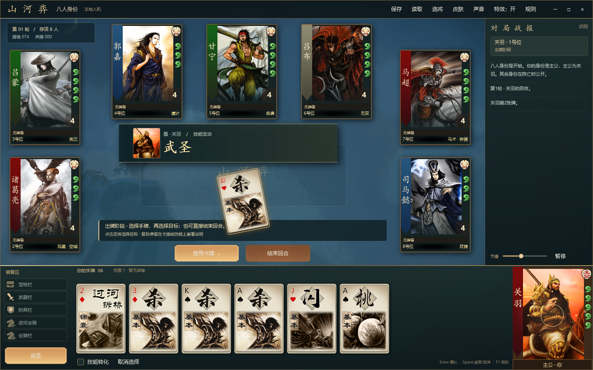
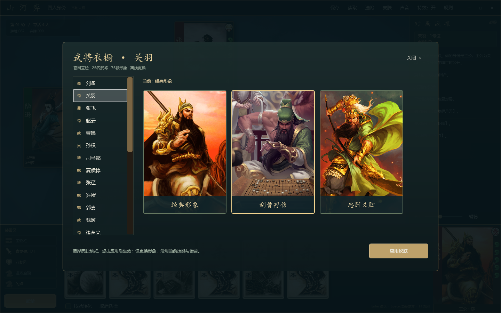
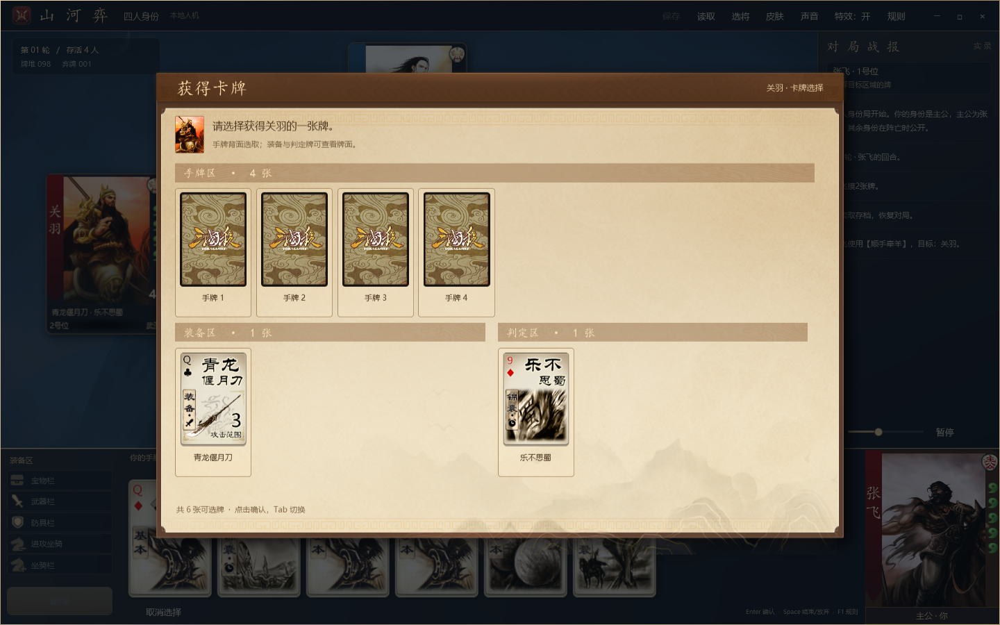

# 山河弈 · C# / WPF 三国策略卡牌

原生 WPF 本地桌面游戏，支持 **90 项武将选择（含25名标准界将）、四人/五人/八人身份局与 2V2**。玩家操作一席，其余席位由 AI 控制。界面与规则引擎独立实现，武将立绘、卡牌牌面、点数和花色直接使用三国杀官网公开资源；素材嵌入程序，运行时不需要联网或WebView。

参考方向：[nonameShijian/noname-shijian-android](https://github.com/nonameShijian/noname-shijian-android)。该仓库采用 Cordova / Android WebView；本工程参考三国卡牌游戏方向，以 C# 重写本地规则与 WPF 界面，未复制其程序或美术资源。








卡牌与技能选择窗口使用官网古卷底板、木色题栏、纹样分区和卡牌背面，以及官方确认/取消按钮。手牌、装备和判定区分开显示；制衡、拼点、改判、观星等选牌显示合法可见牌面、花色与点数，目标选择显示武将头像。“发动／不发动／完成”在底部单独排列，长列表可滚动，保留键盘操作与隐藏信息限制。

## 运行

Windows 10/11，安装 **.NET 10 Windows Desktop Runtime**。开发需 .NET 10 SDK（或支持 .NET 10 的 Visual Studio）。无第三方 NuGet 包。

- 直接打开 `artifacts/app/山河弈.exe`，或双击根目录 `Run.cmd`。
- 源码运行：`dotnet run --project src/Sanguosha.Desktop`。
- IDE 打开 `Sanguosha.slnx`。
- 发布：`powershell -ExecutionPolicy Bypass -File .\Publish.ps1`。

发布目录应整体复制；当前为依赖 .NET 运行时的发布，非单个自包含 exe。

EXE、窗口与任务栏改用原创「山河剑印」多尺寸图标：朱砂墨漆底、鎏金八角印框、交叉双剑与山形印记。标题栏和选将大厅使用同款高清标记。详见 [界面精修说明](docs/UI_POLISH.md)。

## 对局模式

| 模式 | 人数与规则 |
| --- | --- |
| 四人身份 | 1主公、1忠臣、1反贼、1内奸 |
| 五人身份 | 1主公、1忠臣、2反贼、1内奸 |
| 八人身份 | 1主公、2忠臣、4反贼、1内奸 |
| 2V2 | 1/3号位青龙队对抗2/4号位朱雀队，阵营公开，消灭敌方全队获胜 |

身份局可选择玩家身份；主公先行动并增加1点体力。主忠消灭反贼与内奸获胜；主公死亡时反贼获胜；内奸必须成为最后生还者。击败反贼摸三张，主公误杀忠臣弃置全部手牌与装备。2V2无主公加成和击杀奖惩，玩家固定青龙队1号位。

## 原有25名武将（第二批补正主要标准技能）

| 阵营 | 武将 | 本版已实现的技能 |
| --- | --- | --- |
| 魏 | 曹操 | 奸雄：可获得伤害牌；护驾：主公可请求魏将代闪 |
| 魏 | 司马懿 | 反馈：可获得来源一张牌；鬼才：可用手牌改判 |
| 魏 | 夏侯惇 | 刚烈：可判定，非红桃令来源弃两张手牌或受到1点伤害 |
| 魏 | 张辽 | 突袭：用取得其他角色手牌代替摸牌 |
| 魏 | 许褚 | 裸衣：少摸一张，本回合杀/决斗伤害+1 |
| 魏 | 郭嘉 | 天妒：可获得判定牌；遗计：每点伤害可摸二并分配新牌 |
| 魏 | 甄姬 | 洛神、倾国 |
| 蜀 | 刘备 | 仁德：可反复赠手牌，累计两张回一；激将：主公请求蜀将代杀 |
| 蜀 | 关羽 | 武圣：红色牌当杀 |
| 蜀 | 张飞 | 咆哮：杀无次数限制 |
| 蜀 | 诸葛亮 | 观星、空城 |
| 蜀 | 赵云 | 龙胆：杀闪互换 |
| 蜀 | 马超 | 马术、铁骑 |
| 蜀 | 黄月英 | 集智、奇才 |
| 吴 | 孙权 | 制衡：每阶段一次任意手牌/装备换等量牌；救援：主公获吴将桃额外回复 |
| 吴 | 甘宁 | 奇袭：黑色牌当过河拆桥 |
| 吴 | 吕蒙 | 克己：未使用/打出杀时保留全部手牌 |
| 吴 | 黄盖 | 苦肉：失去体力摸两张，可反复发动 |
| 吴 | 周瑜 | 英姿：可多摸一张；反间：随机手牌交对方猜花色 |
| 吴 | 大乔 | 国色：方块牌当乐不思蜀；流离：可弃手牌/装备转移杀目标 |
| 吴 | 陆逊 | 谦逊、连营 |
| 吴 | 孙尚香 | 结姻、枭姬 |
| 群 | 吕布 | 无双：双闪、决斗双杀 |
| 群 | 华佗 | 青囊、急救 |
| 群 | 貂蝉 | 离间、闭月 |

## 第一批新增13项武将

- 标准补充：华雄。
- 界限突破：界曹操、界黄盖、界貂蝉、界周瑜。
- 风：黄忠、魏延；火：典韦、庞德、颜良文丑；林：孟获、祝融；山：张郃。

可选技能有选择弹窗，拼点不泄露未选手牌；标准版与界版同一人物在一局互斥。各技能版本、官网素材覆盖、验证与延期名单详见 [扩展第一批](docs/EXPANSION_BATCH1.md)。第一批报告是历史记录，当前范围见下方第三批说明。

## 第二批新增17项武将（历史交付：总计55项）

- 界限突破5名：界司马懿、界许褚、界甄姬、界吕布、界孙尚香。
- 风4名：曹仁、夏侯渊、小乔、周泰。
- 火2名：庞统、太史慈。
- 林3名：徐晃、孙坚、鲁肃。
- 山3名：姜维、张昭张纮、蔡文姬。

加入交互改判/观星、翻面、横置与属性伤害传导、限定技/觉醒、公示不屈牌区、丧失武将技能和可中断失牌反应；补正原25将的仁德、制衡、结姻、离间、主公技、鬼才、天妒、反间、流离、突袭、遗计等主要差异。技能取经典版本或明确的界版本，不能把同名新版和经典版混用；曹仁为旧据守，周泰为经典不屈。

## 第三批（patch5历史）：新增29项

- 标准后补7名：乐进、李典、甘夫人、潘凤、公孙瓒、伊籍、袁术。
- 界限突破12名：界华佗、界大乔、界张辽、界郭嘉、界诸葛亮、界黄月英、界刘备、界孙权、界赵云、界张飞、界甘宁、界吕蒙。
- 风：张角；火：荀彧、卧龙诸葛亮、袁绍；林：曹丕、董卓、贾诩；山：邓艾、刘禅、孙策。

补充真实多材料用牌、逐目标无懈/反无懈、火攻、酒、无来源闪电、屯田命名区、额外回合与原顺序恢复、公共主公技能、V4存档及旧108张档兼容；重铸不算用牌，使用/判定/响应中的实体牌不能提前洗回。每项有交互和基础AI。

## 第四批（patch6）：核心约定范围已齐

补齐 **于吉、左慈、界关羽、界马超、界陆逊、界夏侯惇**。当前标准/补充33项（原25＋华雄＋后补7）、原标准界将25项、风/火/林/山各8项，共90项。加入经典蛊惑的多人质疑、真假/红桃判定、主动/响应/救援/反无懈；化身私有池、单项技能所有权、性别/势力切换、新生；按类别临时封技、独立于技能存续的谦逊暂存区批量返还、批量连营和新版清俭。

**约定核心名单已完成，不等于完整无名杀移植。** 每名武将的版本在选将说明中标明；于吉是 `old_guhuo` 经典版（无缠怨），左慈为开局两魂的经典 `huashen/xinsheng`，界夏侯惇为 `reganglie/new_qingjian` 而非旧清俭。化身只使用本地已实现核心人物的未登场武将池，不凭空引用尚未实现的上千武将/技能；原标准以外的更多界版、阴/雷和其他包未纳入本轮。新局仍是自定义119张适配牌堆，不是官方完整标准/军争分布与全部装备。AI可知身份；没有网络多人、扩展JS或账号系统。

规则版本、边界与验证见 [核心完成批](docs/EXPANSION_BATCH4.md)，增量覆盖方式见 [patch6说明](docs/PATCH6_APPLY.md)。存档升级V5，可读V2/V3/V4；旧程序不能读V5，请先备份。

## 官方PC对局风格与声音

对局界面采用官方PC客户端的围桌结构：对手按座次分布于两侧和上方、中央出牌区、右侧战报、底部手牌与装备、右下自己的武将。场景、身份图标、体力勾玉、阵营竖条、装备槽使用官网公开图集（确认/取消按钮已改为主题矢量样式）；武将筛选、保存/读取和本地AI设置为本项目功能。

界面采用「墨漆鎏金」主题：深墨蓝/漆色面板、暖金细边、朱砂品牌印记、场景暗角与柔和投影。字体层级、圆角、战报留白与选将卡片统一；确认/取消操作使用清晰的矢量按钮，支持悬停、按下、禁用和键盘焦点状态。手牌保留悬停上浮与选中金色光晕，选将说明区随文字高度调整。公共主题集中在 `src/Sanguosha.Desktop/Themes/InkGold.xaml`。

装备栏使用独立的官方图标列和文字列，保留固定间距；长装备名可悬停查看，避免图标和文字叠在一起。

65名基础人物各有默认形象与两款额外官方静态皮肤，共195张不同图片；25名界将复用同人物官网素材，共270个外观选项。乐进/甘夫人默认为官网国战形象，潘凤为阵前威豪，其余为对应经典形象。大厅“更换皮肤”默认打开所选武将，对局顶部“皮肤”默认打开你的武将，也可在衣橱左侧选择其他武将。选中预览后点击“应用皮肤”生效，选择默认形象即可恢复。选择按武将保存到 `%LOCALAPPDATA%/ShanHeYi/skins.json`，同步用于大厅、对局头像和技能横幅；衣橱打开时暂停AI。皮肤仅改变外观，沿用本版的技能和经典语音，不切换为界限突破规则。

出牌时官方牌面从使用者位置飞向中央，保留实际花色和点数；技能转换按生效牌型展示。杀与指向锦囊带有目标轨迹，闪显示防御光圈，伤害与回复显示实际数值，群体牌在对应座位显示光效。技能发动时使用官方武将头像和技能名横幅。上述特效由WPF动画生成，不新增绘制的武将或卡牌图片。

顶部“特效：开/关”可切换对局动画；特效不拦截鼠标、不驱动规则或随机数，结束后自动清理。暂停、进入大厅/规则/声音设置、切换对局时清理残留动画；同屏最多32个临时特效，避免快速AI回合不断累积。

已加入319个本地MP3：289个官网音频保留已收录武将的技能/阵亡台词及对局音效，另有30个经典卡牌报音，覆盖15种牌的男女声音。出“杀”会报“杀”，响应“闪”也会报牌名；技能转换按生效后的牌型报音。卡牌报音来自无名与太阳神三国杀项目，来源、校验与许可分开记录，详见 `docs/AUDIO.md`。新增六种扩展牌型的独立报牌音及部分武将台词缺失已登记并静默回退，不冒用不同技能语音。读取存档不会重播旧声音。

顶部“声音”打开设置，可分别控制对局音效（含卡牌报音）、武将语音或全部静音，并试听“杀”及当前武将台词。偏好保存在 `%LOCALAPPDATA%/ShanHeYi/audio.json`。卡牌报音独立排队，避免杀与闪相互截断；武将语音最多保留两个近期请求，重复技能合并，阵亡台词优先。所有音频随程序发布，运行时离线播放。

## 卡牌与操作

新局119张适配牌堆：保留原108张牌及编号，并追加4无懈、2酒、2火攻、1铁索、1兵粮、1闪电。原牌包含22张普通杀、4张火杀、4张雷杀，以及闪、桃、决斗、无中生有、过河拆桥、顺手牵羊、南蛮入侵、万箭齐发、桃园结义、乐不思蜀、诸葛连弩、青龙偃月刀、八卦阵、的卢。

- 选择手牌 → 点击目标 → 使用卡牌。装备、桃、群体锦囊无需指定目标。
- 顺手牵羊/过河拆桥出牌后，在弹窗选择目标的手牌区、装备区或判定区；手牌随机抽取，公开牌可以指定。完成后提示实际获得或弃置的牌名。顺手牵羊消耗一张牌并获得一张牌，通常手牌总数不变。
- 关羽、赵云、甘宁、大乔出牌转换时勾选“技能转化”；响应时自动按技能判断是否合法。
- 仁德/结姻/青囊等点击技能按钮发动；苦肉、天义、挑衅和主公激将无需先选手牌；离间/缔盟依次选择两个目标。多张成本、装备转换和连环等在选择弹窗中确认。
- 于吉点击技能后秘密选材料、声明牌型与目标；响应/救援/无懈中同样可声明。左慈在开局与回合开始/结束选择化身及其中**仅一项**技能；当前化身公开，未选化身仅自己可见。
- 弃牌阶段可多选，必须恰好弃至手牌上限。
- 濒死询问桃救援；玩家阵亡后可继续观战。
- 保存/读取 `.shy` 文件，仅自己的出牌阶段、无未结算交互时可保存。V5保存化身池/所选单技、临时类别封禁、手牌禁用、独立命名牌区与既有回合状态；兼容V2/V3/V4。V2固定编号的8张杀会迁移为属性杀，108张旧档不强行加入11张新牌；旧程序不能读取V5。后续重新洗牌使用新的随机序列。
- 大厅与规则窗口暂停AI；大厅点击“入局”才替换当前对局。可调节AI行动间隔或暂停。

| 快捷键 | 功能 |
| --- | --- |
| Enter | 使用、响应或确认弃牌 |
| Space | 结束回合或放弃响应 |
| Esc | 关闭规则并清除选择 |
| F1 | 打开/关闭规则 |
| F11 | 切换最大化 |

玩家使用拆桥/顺手、反馈时可自主选择目标区域；AI自行决策。八卦阵可选择发动，并走可改判流程。青龙偃月刀仅提供范围3；的卢作为距离+1坐骑。兵粮寸断/铁索连环目前由技能生成，未额外增加物理牌。未加入无懈可击、火攻、闪电、酒及完整装备特效。

## 项目结构与验证

- `src/Sanguosha.Core`：无UI依赖的规则、技能、AI和存档校验。
- `src/Sanguosha.Desktop`：WPF界面、选将大厅、卡牌与头像展示。
- `tests/Sanguosha.Verify`：可重复的规则验证与批量模拟，无测试框架依赖。
- `src/Sanguosha.Desktop/Assets/Official`：46张官方基础武将立绘、官方卡牌图集与来源/SHA-256清单。
- `docs/ARTWORK.md`：官方素材来源、牌面切片说明与核验方法。
- `docs/AUDIO.md`：语音来源、播放策略与验证方法。
- `tools/Verify-OfficialAssets.ps1`：核验全部官方素材的文件完整性。

```powershell
dotnet build Sanguosha.slnx --configuration Release --maxcpucount:1
dotnet run --project tests/Sanguosha.Verify --configuration Release
dotnet run --project src/Sanguosha.Desktop --configuration Release -- --verify-ui artifacts/ui
dotnet run --project src/Sanguosha.Desktop --configuration Release -- --verify-audio artifacts/audio-verification
dotnet run --project src/Sanguosha.Desktop --configuration Release -- --verify-effects artifacts/effects
dotnet run --project src/Sanguosha.Desktop --configuration Release -- --verify-skins artifacts/skins
dotnet run --project src/Sanguosha.Desktop --configuration Release -- --verify-dialogs artifacts/dialogs
```

规则验证包含非法攻击、距离、响应、救援、胜负、技能、存档损坏检测及新增武将/界将的专项交互验证，并以固定种子运行400局，覆盖90项武将选择与四种模式（360种组合），并遍历四种玩家身份；每一步检查119张新局/108张旧档实体牌守恒。测试恢复存档时注入固定随机种子，保证重新洗牌后的模拟仍可重复。以下Windows界面验证工具使用WPF离屏渲染大厅、阵营筛选、四种对局布局、选牌、技能转换、响应及结算页，并驱动按钮处理逻辑完成一局，检查绑定错误。截图位于 `artifacts/ui`。本次Linux交叉构建与规则验证通过；新增WPF界面/音频需在Windows执行上述命令复核。

采用4空格缩进、块级命名空间缩进和Allman大括号。武将立绘与牌面源文件保持官网下载内容，程序按官方图集坐标读取牌面；图片版权归原权利人。本项目不代表三国杀或无名杀的官方产品。

### Patch7：选将立绘与响应修复

补齐根素材清单的 WPF 资源嵌入，修正清单字段读取；选将改为虚拟化网格和双工作线程的缓存缩略图，支持方向键、翻页、Home/End 与 Enter 入局。`Run.cmd` 默认构建当前源码，不再自动启动旧 `artifacts\app` 程序；显式运行旧发布目录须用 `Run.cmd --published`，更新发布版请重跑 `Publish.ps1`。详见 [修复与验证说明](docs/PATCH7.md)。

### Patch8：选将退出与目标牌选择

选将页右上新增“退出游戏”，对局未结束时先确认。顺手牵羊、过河拆桥以三区卡牌面板选择：手牌逐张背面，装备及判定牌逐张明置；反馈、突袭、巧变等共享交互，保留各技能可选择的区域限制。详见 [Patch8 行为与验证](docs/PATCH8.md)。

### Patch9：全部武将可滚动到达

修复虚拟化网格回收容器未重新挂回视觉树的问题，保留异步立绘与虚拟化性能；全部90名以及魏24、蜀24、吴23、群19均保留，滚动条常显，长技能说明独立滚动，末行可完整显示。详见 [Patch9 根因与验证](docs/PATCH9.md)。


## patch10 · 官方风格开战与击杀/阵亡特效

已接入十周年官方开战书法/双刀/原音及七档击杀书法字图与原版播报音效，配合异步灰度立绘、官方身份阵亡印章、击杀者高亮及不阻塞操作的 WPF 动画。
支持无来源阵亡、AI/连环伤害、多杀队列、最后一击、跳过、特效/声音独立设置与读档计数。
**素材为官方原文件/裁切，动画为本项目重现，并非官方 Spine 动画逐帧移植。**
详见 [来源、实现边界和验证方式](docs/PATCH10_击杀特效.md)。


## patch11 · 序列帧与音画同步打磨

新增官方原像素序列帧 207 帧，采用原始开战 2 秒主时长；击杀字效现在等待对应阵亡语音结束，与击杀原音同步。加入后台冻结图集、四组 LRU、24Hz 帧时钟及统一座位坐标。详见 [改进、验证与仍未移植的骨骼能力](docs/PATCH11_特效打磨.md)。
