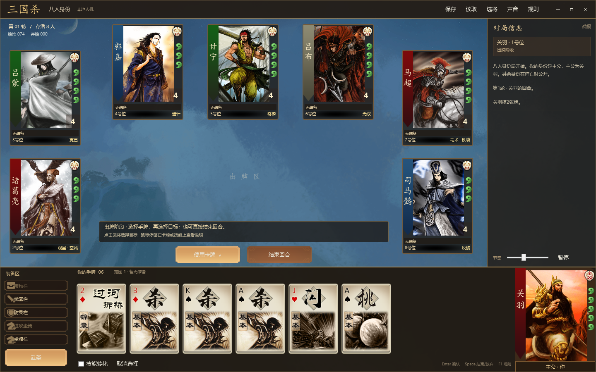
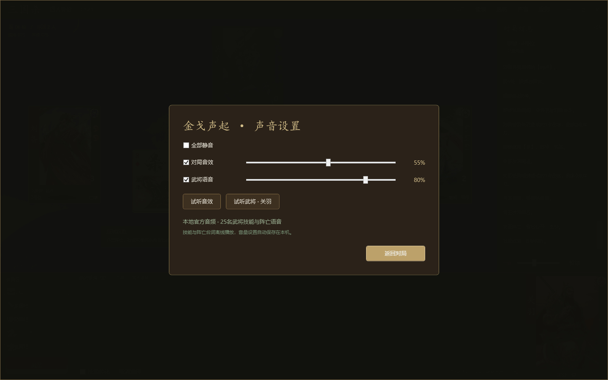

# 山河弈 · C# / WPF 三国策略卡牌

原生 WPF 本地桌面游戏，支持 **25 名武将、四人/五人/八人身份局与 2V2**。玩家操作一席，其余席位由 AI 控制。界面与规则引擎独立实现，武将立绘、卡牌牌面、点数和花色直接使用三国杀官网公开资源；素材嵌入程序，运行时不需要联网或WebView。

参考方向：[nonameShijian/noname-shijian-android](https://github.com/nonameShijian/noname-shijian-android)。该仓库采用 Cordova / Android WebView；本工程参考三国卡牌游戏方向，以 C# 重写本地规则与 WPF 界面，未复制其程序或美术资源。





## 运行

Windows 10/11，安装 **.NET 10 Windows Desktop Runtime**。开发需 .NET 10 SDK（或支持 .NET 10 的 Visual Studio）。无第三方 NuGet 包。

- 直接打开 `artifacts/app/山河弈.exe`，或双击根目录 `Run.cmd`。
- 源码运行：`dotnet run --project src/Sanguosha.Desktop`。
- IDE 打开 `Sanguosha.slnx`。
- 发布：`powershell -ExecutionPolicy Bypass -File .\Publish.ps1`。

发布目录应整体复制；当前为依赖 .NET 运行时的发布，非单个自包含 exe。

## 对局模式

| 模式 | 人数与规则 |
| --- | --- |
| 四人身份 | 1主公、1忠臣、1反贼、1内奸 |
| 五人身份 | 1主公、1忠臣、2反贼、1内奸 |
| 八人身份 | 1主公、2忠臣、4反贼、1内奸 |
| 2V2 | 1/3号位青龙队对抗2/4号位朱雀队，阵营公开，消灭敌方全队获胜 |

身份局可选择玩家身份；主公先行动并增加1点体力。主忠消灭反贼与内奸获胜；主公死亡时反贼获胜；内奸必须成为最后生还者。击败反贼摸三张，主公误杀忠臣弃置全部手牌与装备。2V2无主公加成和击杀奖惩，玩家固定青龙队1号位。

## 25名武将

| 阵营 | 武将 | 本版已实现的技能 |
| --- | --- | --- |
| 魏 | 曹操 | 奸雄：伤后获得伤害牌 |
| 魏 | 司马懿 | 反馈：伤后获得来源一张牌 |
| 魏 | 夏侯惇 | 刚烈：判定后令来源弃两张或失去体力 |
| 魏 | 张辽 | 突袭：用取得其他角色手牌代替摸牌 |
| 魏 | 许褚 | 裸衣：少摸一张，本回合杀/决斗伤害+1 |
| 魏 | 郭嘉 | 遗计：每点伤害摸两张 |
| 魏 | 甄姬 | 洛神、倾国 |
| 蜀 | 刘备 | 仁德：每回合给一张牌并回复1点 |
| 蜀 | 关羽 | 武圣：红色牌当杀 |
| 蜀 | 张飞 | 咆哮：杀无次数限制 |
| 蜀 | 诸葛亮 | 观星、空城 |
| 蜀 | 赵云 | 龙胆：杀闪互换 |
| 蜀 | 马超 | 马术、铁骑 |
| 蜀 | 黄月英 | 集智、奇才 |
| 吴 | 孙权 | 制衡：每回合换一张 |
| 吴 | 甘宁 | 奇袭：黑色牌当过河拆桥 |
| 吴 | 吕蒙 | 克己：未使用/打出杀时保留全部手牌 |
| 吴 | 黄盖 | 苦肉：失去体力摸两张，可反复发动 |
| 吴 | 周瑜 | 英姿：额外摸一张 |
| 吴 | 大乔 | 国色：方块牌当乐不思蜀 |
| 吴 | 陆逊 | 谦逊、连营 |
| 吴 | 孙尚香 | 结姻、枭姬 |
| 群 | 吕布 | 无双：双闪、决斗双杀 |
| 群 | 华佗 | 青囊、急救 |
| 群 | 貂蝉 | 离间、闭月 |

**规则范围**：这是有完整胜负流程的精简规则版本，并非标准版全部技能的逐条复刻。游戏中的技能说明是实际规则。仁德、制衡、结姻、离间及部分自动选择有所简化；未加入护驾/激将/救援、鬼才、天妒、反间、流离等未列出技能。观星、突袭和刚烈自动选择，遗计直接摸牌；离间不限制性别。AI可知身份，用于本地策略对战；没有网络多人、扩展脚本或账号系统。

## 官方PC对局风格与声音

对局界面采用官方PC客户端的围桌结构：对手按座次分布于两侧和上方、中央出牌区、右侧战报、底部手牌与装备、右下自己的武将。场景、身份图标、体力勾玉、阵营竖条、装备槽和确认/取消按钮使用官网公开图集；25将筛选、保存/读取和本地AI设置为本项目功能。

已加入120个官方音频文件，包括25名武将的技能及阵亡语音，以及出牌、装备、受伤、回复、濒死、阵亡和胜负音效。技能转换按实际使用的牌播放音效；部分锦囊使用官方通用切牌音效。语音仅在实际技能发动时触发，读取存档不会重播旧战报。

顶部“声音”打开设置，可分别控制音效、语音音量或全部静音，并试听音效及当前武将台词。偏好保存在 `%LOCALAPPDATA%/ShanHeYi/audio.json`。语音单声道顺序播放，最多保留两个近期请求；重复技能合并，阵亡台词优先。暂停、打开大厅/规则、切换对局和关闭窗口时清理旧声音。所有音频随程序发布，运行时离线播放。

## 卡牌与操作

108张独立牌堆：杀、闪、桃、决斗、无中生有、过河拆桥、顺手牵羊、南蛮入侵、万箭齐发、桃园结义、乐不思蜀、诸葛连弩、青龙偃月刀、八卦阵、的卢。

- 选择手牌 → 点击目标 → 使用卡牌。装备、桃、群体锦囊无需指定目标。
- 关羽、赵云、甘宁、大乔出牌转换时勾选“技能转化”；响应时自动按技能判断是否合法。
- 仁德/结姻/青囊等点击技能按钮发动；苦肉无需手牌；离间依次选择两个目标。
- 弃牌阶段可多选，必须恰好弃至手牌上限。
- 濒死询问桃救援；玩家阵亡后可继续观战。
- 保存/读取 `.shy` 文件，仅自己的出牌阶段可保存。恢复牌堆顺序、身份、回合、体力、装备、判定区、技能次数和战报；后续重新洗牌时使用新的随机序列。
- 大厅与规则窗口暂停AI；大厅点击“入局”才替换当前对局。可调节AI行动间隔或暂停。

| 快捷键 | 功能 |
| --- | --- |
| Enter | 使用、响应或确认弃牌 |
| Space | 结束回合或放弃响应 |
| Esc | 关闭规则并清除选择 |
| F1 | 打开/关闭规则 |
| F11 | 切换最大化 |

拆桥/顺手优先装备，再判定区，再随机手牌。青龙偃月刀仅提供范围3；的卢作为距离+1坐骑。八卦阵自动判定。未加入无懈可击、闪电、酒、属性杀及其他装备特效。

## 项目结构与验证

- `src/Sanguosha.Core`：无UI依赖的规则、技能、AI和存档校验。
- `src/Sanguosha.Desktop`：WPF界面、选将大厅、卡牌与头像展示。
- `tests/Sanguosha.Verify`：可重复的规则验证与批量模拟，无测试框架依赖。
- `src/Sanguosha.Desktop/Assets/Official`：25张官方标准武将立绘、官方卡牌图集与来源/SHA-256清单。
- `docs/ARTWORK.md`：官方素材来源、牌面切片说明与核验方法。
- `docs/AUDIO.md`：语音来源、播放策略与验证方法。
- `tools/Verify-OfficialAssets.ps1`：核验全部官方素材的文件完整性。

```powershell
dotnet build Sanguosha.slnx --configuration Release --maxcpucount:1
dotnet run --project tests/Sanguosha.Verify --configuration Release
dotnet run --project src/Sanguosha.Desktop --configuration Release -- --verify-ui artifacts/ui
dotnet run --project src/Sanguosha.Desktop --configuration Release -- --verify-audio artifacts/audio-verification
```

规则验证包含非法攻击、距离、响应、救援、胜负、技能、存档损坏检测，并以固定种子运行400局，覆盖25将、四种模式和四种玩家身份；每一步检查108张牌守恒。测试恢复存档时注入固定随机种子，保证重新洗牌后的模拟仍可重复。界面验证使用WPF离屏渲染大厅、阵营筛选、四种对局布局、选牌、技能转换、响应及结算页，并驱动按钮处理逻辑完成一局，检查绑定错误。截图位于 `artifacts/ui`。

采用4空格缩进、块级命名空间缩进和Allman大括号。武将立绘与牌面源文件保持官网下载内容，程序按官方图集坐标读取牌面；图片版权归原权利人。本项目不代表三国杀或无名杀的官方产品。
